<p align="center">
  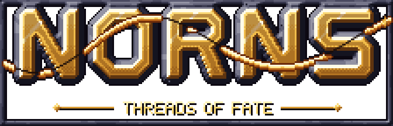
</p>

<p align="center">
  <b>A pixel-art creature-guiding puzzle game in the Lemmings lineage, where you can see fate coming and wind it back.</b><br>
  Three.js + TypeScript · runs in any modern browser · mouse, keyboard or touch
</p>

<p align="center">
  <a href="https://github.com/RobVanProd/Norns/actions/workflows/ci.yml"></a>
</p>

<p align="center">
  <a href="https://robvanprod.github.io/Norns/"><b>▶ Play free in your browser</b></a> &nbsp;·&nbsp;
  <a href="docs/trailer.mp4"><b>Watch the trailer</b></a> &nbsp;·&nbsp; free to play, all rights reserved
</p>

<p align="center">
  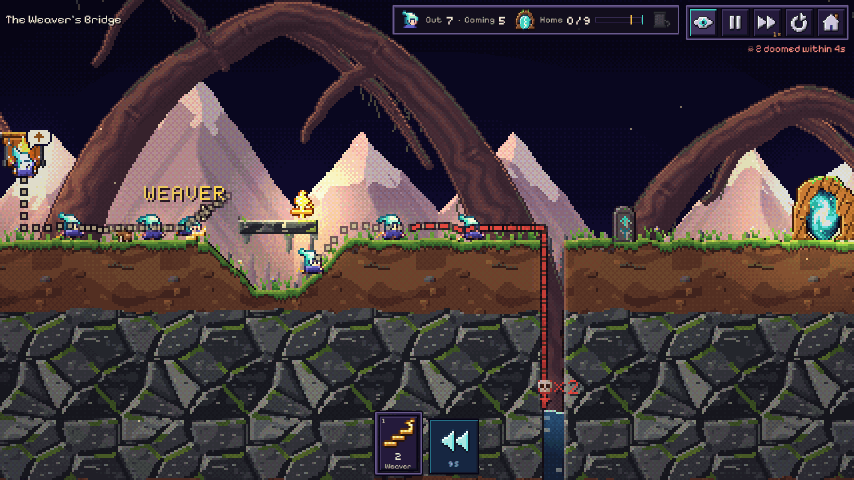
</p>

You play the three Norns of Norse myth. The **Wyrdlings**, small hooded spirits, wander blind
toward their doom. You can't carry them, but you can grant them callings (skills), **see each
one's fate before it happens**, and **rewind time** when fate goes wrong. Lead enough of them
home through the Root Gate to clear a level.

## Trailer

<p align="center">
  <a href="docs/trailer.mp4">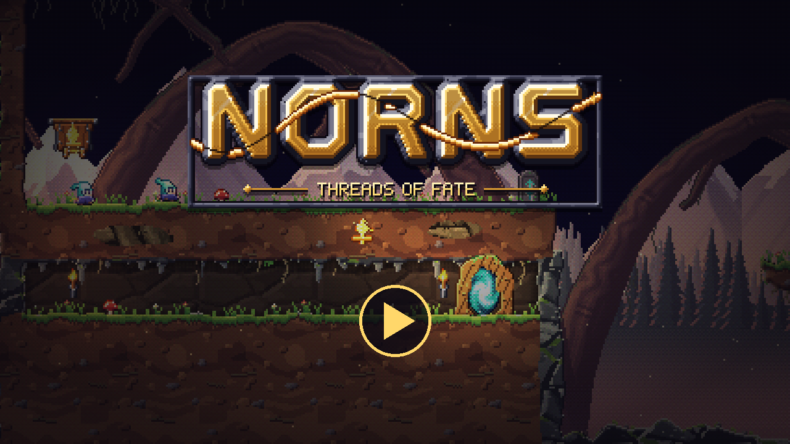</a><br>
  <sub>27 seconds, captured from the game itself with its own soundtrack (MP4). Click the image to watch.</sub>
</p>

## Play it

**Online:** [robvanprod.github.io/Norns](https://robvanprod.github.io/Norns/). It's free, with nothing to
install and nothing to buy. It runs on desktop and phone browsers, and the site is rebuilt from
`main` on every push.

**On your own machine:** you need [Node.js](https://nodejs.org) 20.19+ or 22.12+ (CI uses 22).

```bash
npm install
npm run dev          # open http://localhost:5173
```

`npm run dev` also prints a network address. Open it on a phone on the same Wi-Fi to play
with touch. Landscape is the intended layout.

Other ways to run it:

| Goal | Command | Result |
|---|---|---|
| Static website | `npm run build` | `dist/`: host it anywhere, paths are relative |
| One file you can send or open offline | `node scripts/artifact.mjs norns.html` | a single self-contained `norns.html` |
| Jump straight into a level | open `http://localhost:5173/?level=m2&go` | level ids are `m1`–`m5`, `n1`–`n5`, `u1`–`u5` |
| Watch a verified solution | open `http://localhost:5173/?level=m2&solution&go` | plays the level's scripted solution (dev server only) |

Progress (stars, Threads, upgrades, settings) is saved in the browser's `localStorage`.

## How to play

Wyrdlings drop from the entrance and walk until something stops them. A cliff, a lava pool or
a falling icicle can end one. Each level gives you a limited set of callings: choose one from
the bar, then click or tap a Wyrdling to grant it. Save the quota to clear the level, save more
for a second star, and find the Golden Spindle for a third.

### The twist: three Norn powers

<p align="center">
  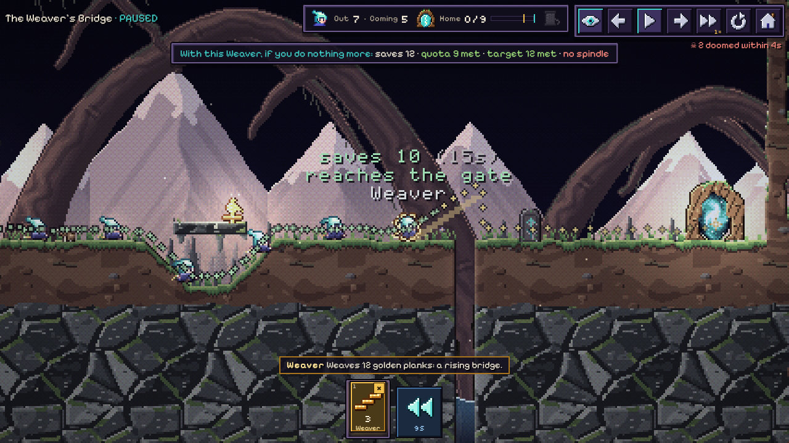
</p>

- **Skuld's Foresight.** Dotted threads show every Wyrdling's next few seconds. A red skull
  marks a death, a spark marks a rescue, and the HUD counts how many are doomed. Arm a calling
  and hover a Wyrdling (on touch, press and hold) to see the branched future before you commit.
  Above, granting Weaver at the gorge edge would leave 2 fewer Wyrdlings lost, so the label is
  green.
- **Verðandi's callings.** Grant skills, pause, step tick by tick, and play at 2×, 4× or ½×.
- **Urðr's Rewind.** Hold to unspool time, as far back as the start of the level. Rewinding is
  never penalised, so experimenting is free. If holding is awkward, set Settings → Rewind to
  Toggle: one press starts it and the next stops it.

Every boss attack is telegraphed with a marker or a warning band. The simulation is
deterministic, so Foresight also predicts exactly who an attack will hit.

### Callings

A level's bar shows its callings in this order. Keys `1`–`9` follow the bar: `1` is always its
leftmost calling.

| Calling | What it does |
|---|---|
| Digger | Digs straight down through soft ground. |
| Weaver | Weaves 12 golden planks: a rising bridge. |
| Warden | Stands firm and turns others back. |
| Basher | Tunnels straight ahead. |
| Miner | Tunnels diagonally downward. |
| Climber | Permanent: scales vertical walls (not smooth rune-iron). |
| Glider | Permanent: glides safely from any height and rides updrafts. |
| Leaper | One big jump forward over a gap. |
| Rune Blast | Plants a rune that bursts 3 s later, carving rock and flinging things. The planter walks on. |

### Controls

| Action | Mouse / keyboard | Touch |
|---|---|---|
| Choose a calling | click the bar, or press `1`–`9` (left to right along the bar) | tap the bar |
| Grant it | press on a Wyrdling (it applies the moment you click) | tap a Wyrdling; press and hold to preview its fate first |
| Put the calling away | `Esc` or right-click | tap the × on the armed calling |
| Pan | drag empty space, arrow keys or WASD, mouse wheel | drag |
| Zoom | `+` / `-`, or Ctrl + wheel | pinch |
| Pause | `Space` or `P` | pause button |
| Step one tick while paused | `,` back / `.` forward (with Shift: one second) | ◀ / ▶ beside the pause button |
| Speed 1× / 2× / 4× / ½× | `F` | speed button |
| Rewind | hold `R` (or Backspace); in Toggle mode press once to start, again to stop | hold ◀◀; in Toggle mode tap to start, tap to stop |
| Foresight on/off | `V` | eye button |
| Menu | `Esc` (when no calling is armed) | home button |

Settings → Keys rebinds the calling slots, pause, rewind, speed, Foresight and the tick steps (a key
already in use moves over). Settings → Access has Reduce motion (no screen shake or flashes and a
still backdrop; it starts on if your system asks for reduced motion), a text size and how far from a
Wyrdling a finger may land and still pick it.

## Three realms, eighteen levels, three bosses

| Midgard | Niflheim | Muspelheim |
|---|---|---|
| 1. First Threads | 1. Frozen Steps | 1. Ember Road |
| 2. The Weaver's Bridge | 2. Glacier Depths | 2. The Cracked Floor |
| 3. Hold the Line | 3. Avalanche Pass | 3. The Forge |
| 4. Through the Stone | 4. Rime Gate | 4. Surtr's Gate |
| 5. Climb, Little Thread | | |
| 6. Fall Like a Leaf | | |
| 7. Roots and Wings | | |
| **Boss: The Gnawing Wyrm** | **Boss: Hrímgrímnir, the Frost Jötunn** | **Boss: Surtr's Herald** |

Puzzles are built from physical pieces:

- destructible pixel terrain, and falling sand and snow;
- rolling boulders that bowl Wyrdlings over, crack thin floors, and cool into stepping stones in lava;
- plates and levers wired to gates and bridges;
- snow hoppers, updrafts that carry gliders, and gas flames that burn in turn;
- water and lava.

| Niflheim: a snow hopper pours powder into a pit | Muspelheim: a column of Wyrdlings descends past lava falls |
|---|---|
| 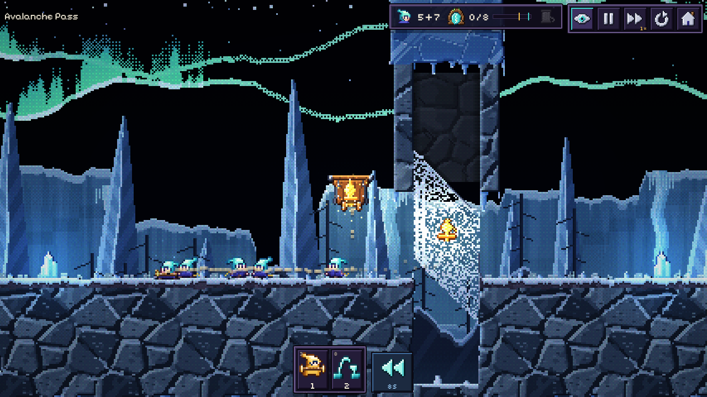 | 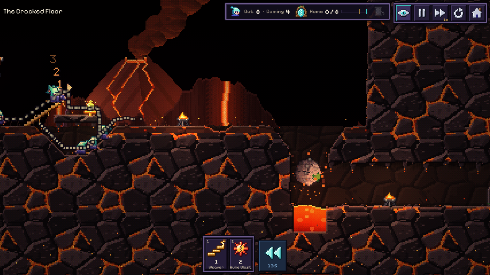 |

Bosses are hurt only when a Wyrdling steps onto the glowing **Seiðr stone**. Each time one
fires, another stone lights up somewhere else in the arena.

| The Gnawing Wyrm spits venom | Hrímgrímnir punches down through the ice | A Seiðr beam strikes Surtr's Herald |
|---|---|---|
| 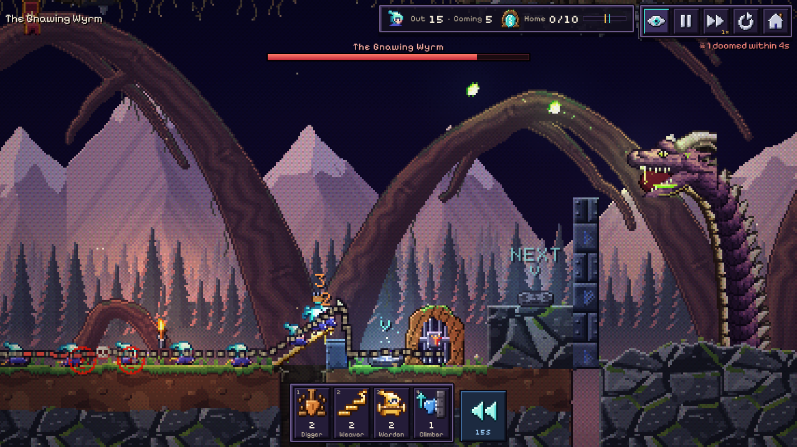 | 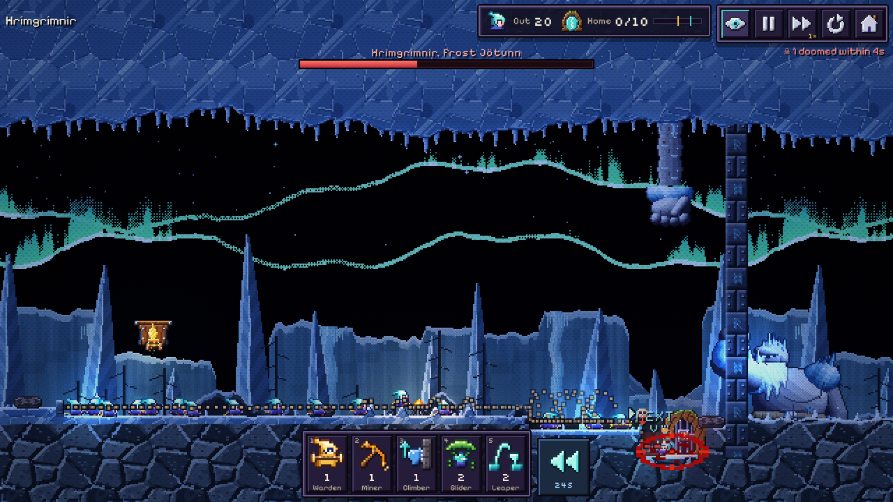 | 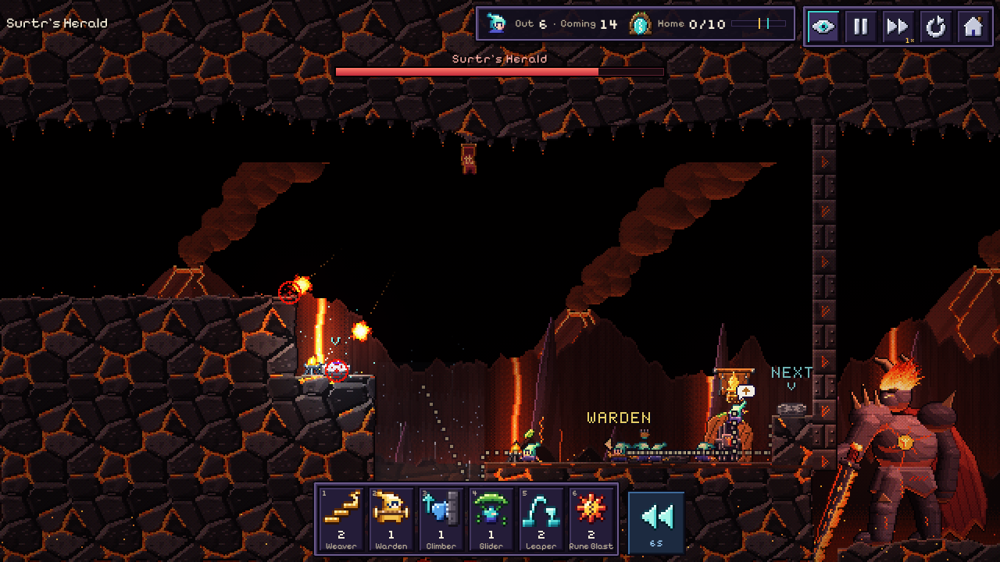 |

## Progression

- **Stars**: one for meeting the quota, one for the higher target, one for the Golden Spindle.
- **Unlocks**: clearing a level (meeting its quota) opens the next two levels in its realm. A
  realm's guardian wakes once three of its puzzle levels are cleared. The next realm opens when
  the guardian falls, or when every puzzle level in the realm is cleared. The second and third
  stars never lock anything.
- **Threads**: earned per new star (5 each) and for beating your best save count. Spend them at
  **the Loom**:
  - longer Foresight (4 → 10 s);
  - six hood dyes for your Wyrdlings.
- **Skuld's Vision** replays a verified solution if you're stuck. It's offered after a failed
  attempt and in the pause menu.

| The world map | Phone, landscape |
|---|---|
| 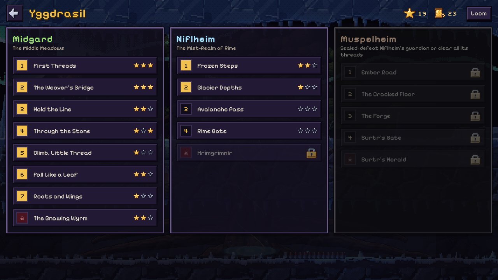 | 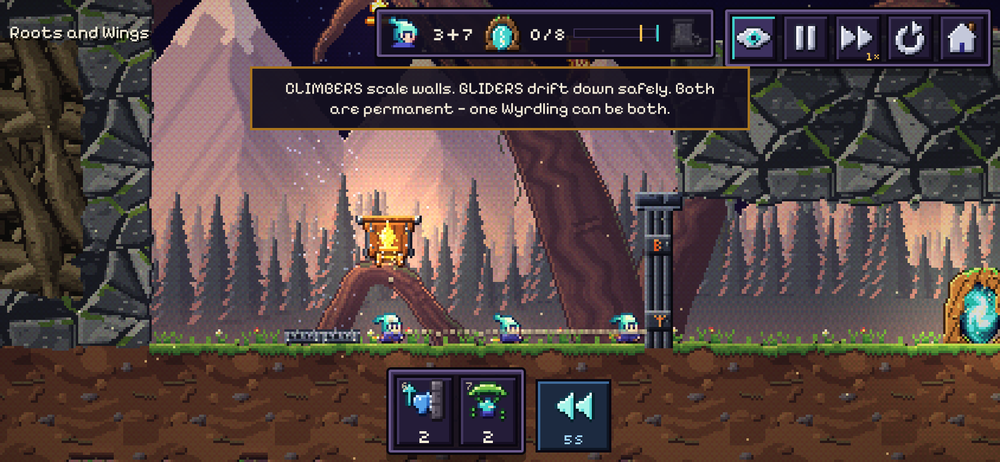 |

## Everything is generated in code

There are no image or audio files in the game itself. At startup the game builds:

- **Art**: hue-shifted pixel art, parallax skies, terrain shaded per pixel in a shader, banded 2D
  lighting and particles.
- **Audio**: a sample-based synth plays an original soundtrack (title, map, three realm themes,
  a boss theme with 3 intensity layers, finale, and stingers) plus 63 sound effects.

The view always uses whole-pixel scaling and never shows past a level's edges, at any screen
size.

## Free to play, all rights reserved

NORNS is free to play, with no ads and nothing to buy.

The source code is public so you can see how it's made, but **no license is granted**. Copying,
modifying, redistributing or reusing its code, art, music or levels needs written permission
from the author. GitHub's Terms of Service let people view and fork public repositories on
GitHub; nothing beyond that is granted.

© 2026 RobVanProd. All rights reserved.

Third-party components keep their own licenses:

- [three.js](https://threejs.org/) (MIT);
- the [Pixelify Sans](https://fontsource.org/fonts/pixelify-sans) and
  [Silkscreen](https://fontsource.org/fonts/silkscreen) fonts (SIL Open Font License 1.1).

Their notices are in [public/THIRD_PARTY_NOTICES.txt](public/THIRD_PARTY_NOTICES.txt) and ship
with every build.

## For developers and AI agents

**[AGENTS.md](AGENTS.md)** is the working guide. It covers commands, architecture, the
invariants you must not break, how to add a level, and the dev-only debug hooks. Other docs:

- [DESIGN.md](DESIGN.md): game design.
- [docs/ART_SPEC.md](docs/ART_SPEC.md): pixel-art rules.
- [docs/AUDIO_SPEC.md](docs/AUDIO_SPEC.md): the sound engine and score.

```bash
npm test             # simulation tests + every level's scripted solution
npm run typecheck    # TypeScript, no emit
npm run build        # typecheck + production build to dist/
```

```
src/sim/      deterministic simulation (no DOM): terrain, Wyrdlings, physics, sand, bosses,
              foresight (time-sliced clone-ahead), timeline (rewind), scripted solutions
src/levels/   level data: terrain shape ops, entities, scripted solution per level
src/render/   Three.js low-res pipeline, terrain shader, instanced sprites, lights, particles
src/game/     play scene, view (sim → sprites + juice), input, menus, save/progression, sound map
src/art/      procedural pixel-art generators
src/audio/    offline-synthesised instruments, sequencer, songs, SFX
tests/        vitest suites;  scripts/  level previews, traces, browser checks, frame capture
```

The simulation uses only IEEE-exact arithmetic (no `Math.random`, `sin` or `pow`). Its terrain
is chunked and copy-on-write, so cloning a whole game state is cheap. That is what makes
Foresight (a real simulation run ahead on a clone) and Rewind (a ring buffer of clones)
possible.

**How it's verified**

- Every level ships with a scripted solution.
  - The tests check that it reaches the second-star target, collects the spindle, and defeats
    the boss.
  - The tests also check that playing with no callings fails the quota, so no level wins itself.
- A headless-browser smoke test walks through the title, map, play and phone layouts and fails
  on any page error.
- The screenshots on this page were captured with `scripts/frames.mjs`, which steps the
  simulation to exact ticks.

**Known limits**

- Nobody has listened to the music or sound effects yet. They are checked only by offline
  rendering: nothing is silent, nothing clips, no NaNs.
- No human playtest yet. Boss balance is tuned so a scripted, non-reactive solution wins.
- Visual checks ran in headless Chromium. Real phones, Safari/iOS and low-end GPUs are untested.
- Portrait phones get a "rotate" prompt.
